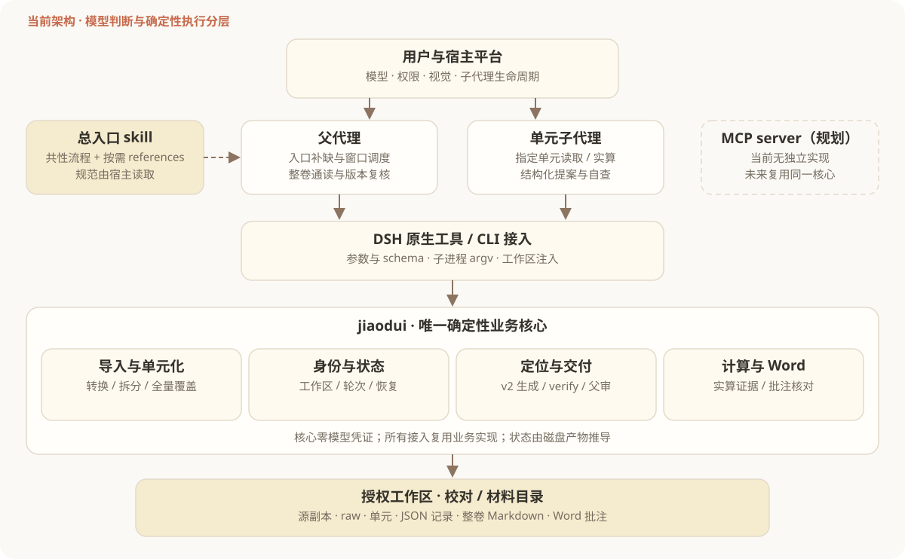
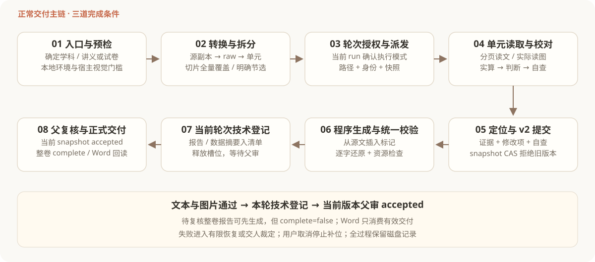

# JiaoDuiAgentSkill：项目架构与设计

> 汇报版 · 2026-10-13 · Python 包 `jiaodui` 0.1.0 · 审查基线 `07d0f38`
>
> 本文以当前代码、PRD、ADR 和本次实测为依据。历史验收记录、当前实现、规划能力分别说明；不将自动测试通过等同于模型校对质量达标。
>
> 2026-10-23 状态更新：R2 已由 `c5af354` 修复；R1 计算隔离与 R3 数值精度仍待处理。材料锁按平台使用系统锁，Windows 实现尚待实机验收。

## 1. 项目定位与汇报结论

JiaoDuiAgentSkill 面向 K-12 教辅材料校对，将旧系统的“自研 agent 循环与 GUI”重构为“宿主 agent 驱动、可分发 skill、确定性 Python 核心”。agent 负责理解题意、判断错误、提出修改和复核；Python 负责转换、切分、定位、计算、校验、记录和生成交付文件。

最关键的设计变化是：**模型提交结构化修改提案，程序从源文生成完整报告**。模型无需重写整篇材料，程序保留源文、插入标记、执行一致性检查，再由父代理复核当前版本。项目价值在于减少正文遗漏、虚构标记、过期交付和修改建议丢失，并让恢复过程可追溯。

| 汇报维度 | 当前结论 |
| --- | --- |
| 实施状态 | schema v2 结构化主链已合入；CLI 与 DSH 插件已实现 |
| 学科范围 | 高中物理已落地；其余六科仍在扩展计划中 |
| 通用接入 | skill 与 CLI 可复用；独立 MCP server 尚未实现 |
| 审查基线验证 | 双口径均为 1,268 passed，另有 4 subtests passed；无失败、无跳过 |
| 工程规模 | 45 个 Python 文件、约 1.38 万行；62 个测试文件，仅作规模参考 |
| 优先风险 | 计算沙箱隔离、小量数值精度；迟到取消的 attempt 绑定已由 `c5af354` 修复。详见第 11 节 |

## 2. 目标、边界与角色

**产品目标**：对试卷、讲义完成单元校对，交付整卷 Markdown 报告和 Word 批注版。每条错误必须有可见修改建议；不合格报告不能冒充正式完成；失败和资源缺失必须留痕。

**系统边界**：Python 不调用模型 API，不管理模型凭证，不实现聊天 GUI，不在内部重建 agent 循环。原始材料保持不变，导入后在工作区副本与标准产物上工作；旧仓 `../JiaoDuiAgent` 冻结，不作为运行时依赖。

| 角色 | 负责内容 | 关键约束 |
| --- | --- | --- |
| 用户 | 提供材料、学科与类型；确认执行模式；裁定争议与失败 | 用户已明确的信息直接采用；取消具有最高停止效力 |
| 父代理 | 入口补缺、视觉能力确认、拆分选择、窗口调度、整卷通读与父复核 | 单元阶段不逐份读取源文；入口学科与类型识别共用 2,000 字符额度 |
| 单元子代理 | 读取指定单元与图片、实算、校对、自查、提交 v2 提案 | 仅接收路径与身份；禁止嵌套派发、修改源文和自由命名产物 |
| 确定性核心 | 执行工具、判定结构契约、保护写入边界、登记状态、生成文件 | 核心逻辑单一；下游必须重新核对当前产物 |
| 宿主平台 | 模型、读图、子代理生命周期、权限、用量数据 | 真实能力必须在宿主验证，CLI 无法独立证明 |

本次审查只读取项目代码、规范与测试夹具；问题复现使用自动清理的临时合成材料，不逐单元读取真实教材源文。

## 3. 总体架构



架构分为三层：宿主提供推理与调度，接入层提供流程规范和协议转换，Python 核心提供唯一的确定性实现。当前 DSH 原生工具通过子进程调用 CLI；MCP 是未来通用接入目标，不能在汇报中列为现有组件。

| 层级 | 当前载体 | 设计职责 |
| --- | --- | --- |
| 宿主层 | 父代理、单元子代理、实际读图工具 | 语义判断、派发、复核、用户交互 |
| 规范层 | `skills/jiaodui/SKILL.md` 与 references | 共性流程一次定义，学科规则按需披露 |
| 适配层 | `jiaodui/cli.py`；DSH `tools/index.js` 与 preset | 参数解析、schema 投影、进程调用、输出与取消传播 |
| 核心层 | `jiaodui/` 业务模块 | 转换、切分、状态、计算、报告校验、交付与恢复记账 |
| 持久化层 | 材料记录 JSON、单元 Markdown / JSON、图片、Word | 跨会话恢复、摘要绑定、当前交付与历史轮次追踪 |

skill 是宿主行为规范，不是 Python 的另一份业务实现。CLI 即使脱离插件仍能执行确定性流程；模型能力由调用方提供。

### 3.1 核心模块划分

| 子系统 | 主要模块 | 输入与输出 |
| --- | --- | --- |
| 导入与入口 | `inspect_source.py`、`material_type.py`、`convert.py` | 文档结构事实、有限预览；docx / doc / md / idml 到 raw Markdown 与图片 |
| 单元化 | `split.py`、`workflow.py`、`units.py` | 规则 / 人工标记 / 整篇拆分，或宿主给定行区间；写出契约单元 |
| 身份与轮次 | `material.py`、`workdir.py`、`paths.py` | task / unit / run 身份、工作区授权、输入摘要与材料记录 |
| 定位与提交 | `unit_reader.py`、`source_index.py`、`report_suggestions.py`、`unit_delivery.py` | 分页源文、版本绑定位置、v2 提案；生成并登记报告 / 数据 |
| 校验与复核 | `markers.py`、`verify.py`、`inspect_images.py`、`review.py` | 标记真实性、正文完整性、资源、当前版本 accepted 复核 |
| 状态与恢复 | `status.py`、`execution_policy.py`、`error_classification.py`、`failure_note.py` | 磁盘状态、调度建议、阶段心跳、有限恢复预算与失败记录 |
| 确定性计算 | `calc/operations.py`、`schema.py`、`templates.py`、`sandbox.py`、`dimensional.py`、`chemistry.py` | 14 类计算 operation、白名单元数据、子进程结果与证据 |
| 最终交付 | `report.py`、`report_parse.py`、`docx_report.py`、`docx_comments.py`、`formula_render.py` | 整卷报告、Word 批注与公式兜底；回读并核对实际锚点 |
| 兼容修复 | `report_repair.py`、旧报告解析入口 | 历史 Markdown 报告读取与确定性修复；不承担正常 v2 提交 |

### 3.2 宿主适配设计

DSH 插件由 package、profile patch、原生工具和随包 skill 组成。本次加载适配器统计到 27 项原生工具；preset 子代理白名单共 21 项，包括 skill、只读文件与图片、单元工具、恢复工具和 12 项计算工具。父侧持有取消、父复核与交付权限。

适配器逐次从会话取得工作区，同时设置子进程 cwd 和 `JIAODUI_WORK_ROOT`。它以 argv 调用 CLI，不拼接 shell 命令；默认超时 180 秒、stdout / stderr 各 64 KiB 上限，返回截断标记。用户中止按 AbortError 传播，技术失败保留已收集的诊断。工具实际可见范围还受宿主注入影响，需真实 catalog 验收。

## 4. 主流程与交付生命周期



1. **入口补缺**：用户已明确的学科或类型直接采用；未知类型先读 Word 嵌套表格统计，必要时有限预览或询问。大量嵌套表格承载正文是讲义强信号。
2. **环境与视觉门槛**：`check-env` 检查本地 Python、pandoc 等；宿主另行确认一层子代理、真实读图和交付能力。子代理无视觉能力时拒绝校对。
3. **转换与拆分**：`convert` 保存源副本和 raw；`split` 提供规则、人工标记、整篇策略；复杂边界由宿主判断后交给 `slice`。默认 full 切片要求每个非空行恰好覆盖一次。
4. **确认当前轮次执行模式**：拆分后登记 automatic / interactive；新轮次会使旧授权失效。确认绑定当前 run，不凭历史记录继续授权。
5. **窗口调度**：`dispatch-plan` 默认给出 8 个并发槽位的建议；宿主负责实际派发、补位与停止。子代理收到工作区、目录、身份、快照与 references 路径。
6. **单元校对**：子代理通过 `unit-read` 分页读取，通过实际读图工具看图，按需实算；用 `unit-locate` 获取重复短语候选和安全位置。
7. **结构化交付**：先自查，再以 snapshot 摘要提交 v2 提案。核心定位、生成全文、校验文本与图片、写报告和数据，最后登记材料记录。
8. **父复核与汇总**：程序可先生成 `complete=false` 的待复核整卷报告供父代理通读；父代理对当前 snapshot 作 accepted / needs_revision 决定。全部有效单元 accepted 或显式跳过后才可正式完成。
9. **最终 Word**：重新核对当前状态，转换正文并植入批注，回读 OpenXML 检查锚点、公式兜底与图片。失败产物不作为通过的正式交付。

正式完成具有三个不同层次：**文本与资源校验通过 → 当前轮次技术登记 → 当前版本父复核 accepted**。文件存在或 `unit-submit` 返回 registered 都不能单独表示最终完成。

## 5. 数据与工作区设计

### 5.1 标准产物布局

```text
工作区 W/
└── 校对/<材料名>/
    ├── source/                         源文件副本与导入资源
    ├── raw/
    │   ├── <材料名>_raw.md
    │   └── <材料名>_images/media/
    ├── units/<材料名>/
    │   ├── 第1题/ 或 单元1/
    │   │   ├── 第1题.md 或 单元1.md
    │   │   ├── images/
    │   │   ├── _校对报告.md
    │   │   ├── _校对数据.json
    │   │   └── _校对失败.md              发生失败时
    │   └── .superseded/<run_id>/        陈旧单元整体归档
    ├── _校对记录.json
    ├── 校对报告/<材料名>_整卷报告.md
    └── 校对Word/                       Word 批注交付
```

单元内允许既有跳过标记，禁止自由命名 attempt 文件与副本报告。只保留当前交付正文；轮次、恢复、计算和复核摘要进入材料记录。改变单元集必须显式使用 `--replace-units`，陈旧单元只移动、不删除，归档目录不参与当前扫描。

### 5.2 持久身份与摘要

| 数据对象 | 核心字段 | 作用 |
| --- | --- | --- |
| 材料 | `task_id`、`material_name`、`paths`、`unit_set`、`unit_ids` | 持久身份和当前目录集合，不依赖会话记忆 |
| 输入 | `unit_inputs`、source SHA-256、图片相对路径与 SHA-256 | 源文或图片变化后，旧提交与登记失效 |
| 轮次 | `current_run_id`、`runs[]`、params、resources、actions | 显式重跑、参数或资源变化产生新轮次 |
| 技术登记 | `unit_records[]`、run、report / data 摘要、inputs | 证明磁盘报告与结构化数据属于当前输入和轮次 |
| 过程记录 | `unit_events`、`unit_state`、`terminated_attempts`、`recovery`、`calc_calls` | 在途与停止判断、预算、计算证据、旧尝试终结 |
| 父复核 | `unit_reviews[]`、decision、report / proposal / self_check 摘要、inputs | accepted 只对对应版本有效；保留历史决定 |
| 提交快照 | task / unit / run、inputs、report / data 摘要、next revision、snapshot SHA-256 | Compare-and-swap：拒绝用旧判断覆盖新版本 |

`source_sha256` 绑定源文件字节，`body_sha256` 绑定正文文本；当前正文提取是恒等操作，两者通常相同但语义不同。位置 ID 绑定源文本摘要和字符区间，重复短语不能仅凭文字猜测位置。

### 5.3 写入与并发策略

工作区由宿主显式注入或 CLI `--work-root` 指定。`ensure_inside` 对真实路径 resolve 后校验，覆盖符号链接越界；可能被子进程写入的目录树也预先核对。

材料级互斥使用材料根目录的持久 `.jiaodui.lock` 文件：POSIX 由 `fcntl.flock` 锁定，Windows 由 `msvcrt` 锁定首字节，进程内另有线程互斥。锁文件不得删除；锁等待最多 120 秒（低于插件 180 秒子进程预算，保证超时能返回结构化错误）。提交在锁内比较 snapshot。报告、数据和清单各自使用临时文件、fsync 与原子替换，清单登记作为最终提交标志；捕获到异常时恢复先前内容。这属于**文件级原子替换与异常回滚**，没有跨文件数据库事务或崩溃恢复日志，不应宣称断电时整个提交天然原子。未匹配的摘要会使下游拒绝消费。

材料锁现有 POSIX 与 Windows 实现；Windows 分支尚待实机验收。网络共享目录上的锁语义仍未纳入支持范围，需单独实测。

## 6. 结构化报告设计

### 6.1 v2 提案

提案顶层包括 `schema_version`、task / unit / run 身份、source / body 摘要、`proposal_revision`、`summary`、`corrections`、`evidence` 与 `self_check`。

| 提案部分 | 设计要求 |
| --- | --- |
| 修改项 | id、location_id、expected_original、replacement、reason、category、severity、evidence_ids |
| 首轮证据 | 假设 / 依据、符号；图片逐项对应实际引用清单；计算引用当前单元当前轮次的 call_id |
| 计算核验 | 证据须指向成功调用；表达式与返回 result 对照，不允许手写结果冒充实算 |
| 自查 | 有问题需覆盖真实性、修改语义、关联覆盖、范围与不确定性、严重度；无问题需 no_issue_review |
| 版本 | revision 递增；snapshot 过期拒绝；重复 ID、重叠区间、空操作、原文不符均拒绝 |

核心从不可变源文插入 `【编号|原文|修改建议】`，而不是把全文改写责任交给模型。竖线、反斜杠和标记括号有统一转义；读写使用同一套编码函数。v2 报告带正文长度边界，正文中的“修改原因”等标题不会误切报告。

**核心不变量**：去掉标记并还原原文字段后，生成的正文必须逐字等于单元源文。图片证据绑定真实清单，但这只能证明路径与引用对应，不能证明模型确实理解图片。

### 6.2 单一交付闸门

`verify_unit` 是完整闸门，CLI `verify-report`、结构化提交和下游生成复用它。它检查分段与标记语法、原因编号对应、严重度、标记真实性、原文完整性和图片资源。

`build-report` 的 `ok` 只表示生成了诊断文件；`complete` 才表示所选范围完整完成。待复核单元可进入诊断报告，但列入 `unreviewed`，此时 complete 为 false。缺失或不合格单元显示占位，未通过正文不被拼入。

Word 只消费符合当前交付条件的单元。生成后逐单元核对：标记数 = 实际批注锚点数 + 公式可见兜底数，缺失与超额均为 0，图片缺失为 0，并校验 comments.xml 与 RangeStart / RangeEnd / Reference 的配对结构。计数和结构校验不能代替版式与内容质量人工验收。

### 6.3 历史兼容的实际边界

正常交付采用 v2；`parse-report` 禁止覆盖 v2 的结构化数据，`repair-report` 只服务旧报告。

但是当前 `parse_unit` 仍可把通过闸门的 v1 Markdown 报告登记到新布局材料，且不要求 v2 父复核。因此，“旧报告完全只读”尚未成为所有入口的硬约束。这是既有 T09 待决策项：需要明确保留显式人工兼容交付，或禁止该登记；本汇报不将其隐藏为已完成能力。

## 7. 状态、调度与失败恢复

### 7.1 磁盘状态与调度状态

| 状态 / 阶段 | 条件与动作 |
| --- | --- |
| 未开始 | 没有报告，进入待派发候选 |
| 已交付未过校验 | 有报告但不通过闸门；允许预算内修正 |
| 失败 | 不通过且有失败记录；交人裁定，不自动当作普通待派发 |
| 本轮未完成 | 文本通过，但缺当前登记或当前 v2 accepted 复核 |
| awaiting_parent_review | 有效 v2 已技术提交；释放执行槽位，等待父复核，不自动重派 |
| needs_revision | 父代理退回；重新进入候选，由宿主决定定向复核与派发 |
| 已完成 | 当前输入 / 轮次登记匹配；v2 还须 accepted |
| 跳过 | 有显式跳过标记；整卷和 Word 按一致口径排除校对 |
| cancelled / stale | 停止补位或提示超时；用户取消不自动重试，技术取消可显式撤销 |

已有有效的本轮完成产物不会因为旧 `_校对失败.md` 而回退。重新拆分、报告或数据改变、输入摘要变化则重新计算状态。

`dispatch-plan` 是只读调度建议，不会实际创建子代理或预占槽位。宿主仍负责先派发并登记心跳，避免多个调度方根据同一份计划重复派发。默认 8 个槽位也不是吞吐性能承诺。

### 7.2 恢复预算

| 类别 | 每单元每轮额度 | 用途 |
| --- | --- | --- |
| call_correction | 2 | 工具调用参数修正 |
| calc_representation | 2 | 计算表达方式调整 |
| report_repair | 3 | 旧报告修复 |
| targeted_review | 2 | 定向复核 |
| technical_redispatch | 1 | 技术失败重派 |
| image_schema_fix | 2 | 图片调用 / 证据格式修正；同时扣 1 次 call_correction |

错误码确定性映射类别。`attempt_id` 与稳定失败 SHA-256 实现幂等；同 attempt 改指纹或类别拒绝，重放与额度拒绝都不写盘。连带扣费任一余额不足时整次拒绝，不部分扣费。用户取消与权限拒绝只记录、不耗预算。

**当前强制范围**：core 强制恢复记账入口的授权、分类、扣费和幂等；宿主负责每次恢复前调用该入口并遵守 allowed。提交 / 计算入口尚未全部绑定恢复票据，因此这不是不可绕过的全链路重试次数上限。该职责边界对应既有 T10。

失败说明必须包含原因、最后一次 verify 完整输出和产物摘要。报告不能通过则不算完成，不以截断原因或隐藏失败凑完成率。

## 8. 计算、图片与学科扩展

计算核心按注册元数据导出 schema，支持 evaluate、simplify、solve、equality、differentiate、integrate、formula、dimensional、limit、geometry、vector_ops、circle_from_two_points、chemistry_balance、stoichiometry 共 14 类操作。高中物理配置只开放对应工具族；存在化学计算实现不等于高中化学校对流程已经落地。

公式多根显式返回歧义，不猜第一根；圆轨迹返回前核对两点等距及方向条件。量纲声明支持单位表达式、显式量纲、物理量名与单位，以及候选读数组合；每个符号必须声明，无量纲也需明确说明。agent 仍负责物理建模、符号对应和分支选择。

图片清单按正文引用次序绑定 reference_index、位置、原图和实际读取路径。透明线稿可提供白底读取图；缺图、无效图或不支持的远程引用会阻止交付。真实 `read_image` 执行与视觉理解由宿主验收，不能由证据对象自行证明。

学科差异采用两类载体：人读 `references/subjects/<学科>.md`，机器读包内 `jiaodui/data/subjects/<学科>.json`。后者控制扩展名、拆分参数和工具族；仓库根 `config/subjects/` 是镜像，不读取工作区同名配置，开发覆盖使用 `JIAODUI_CONFIG_DIR`。扩科要求规范、配置、独立语料和宿主验收配套，不能只新增一行矩阵。

## 9. 部署、接口与运维

| 项目 | 当前方案 |
| --- | --- |
| 运行环境 | Python ≥3.12；本机 3.12.13；独立 venv，`.venv` 可指向仓内 `.venv-cli` |
| 必需依赖 | sympy、python-docx、Pillow、lxml；外部 pandoc，本机 3.9.0.2 |
| 可选依赖 | matplotlib 公式渲染惰性加载、缺失降级；Playwright / classics 后置 |
| 分发 | setuptools wheel，含默认学科 JSON；skill 与 DSH bundle 单独提供 |
| CLI 输出 | JSON 与稳定退出码；失败 stderr 单行结构化 JSON |
| 退出码 | 0 成功；1 未预期；2 用法；3 环境；4 校验；5 未找到；6 契约；7 不支持 |
| 工作区权限 | 宿主注入 `JIAODUI_WORK_ROOT`，或显式 `--work-root`；产物真实路径必须在内 |
| 并发 | 同材料写入序列化；模型判断可按单元并行；共享 JSON 仍是持久化中心 |
| CI | Ubuntu 24.04、Python 3.12、Node 22、pandoc；全量 pytest 与 wheel 构建 |

独立 Python 环境用于避免 macOS 宿主签名解释器拒绝加载 pip 原生扩展。插件优先发现仓库 `.venv/bin/jiaodui`，找不到时回退 PATH 或显式配置 CLI 路径。

本地核心记录阶段、恢复、调用结果和产物摘要；模型 token、费用与真实调用耗时归宿主采集。本次没有新增宿主用量实测，也不根据测试时长推导生产吞吐或成本。

## 10. 关键设计取舍与质量证据

| 取舍 | 得到的价值 | 需要接受的代价 |
| --- | --- | --- |
| 宿主 agent 驱动 | 核心不绑定模型 API，复用宿主权限与读图能力 | 不同宿主必须分别验证工具和调度语义 |
| 结构化提案生成报告 | 源文完整性可确定性约束，证据与定位可核对 | 模型必须适应 schema；源文改变需重新定位与提交 |
| 磁盘推导状态 | 跨会话恢复，避免内存状态与文件脱节 | 扫描、摘要和共享 JSON 会增加 I/O |
| 材料锁 + 文件原子替换 | 实现简单、可本地部署，保护协作写入 | 按平台使用系统锁；Windows 尚待实机验收；多文件断电恢复非完整事务 |
| 单一 verify 闸门 | CLI、提交、Word、整卷消费判据一致 | 校验较严格，需要清晰诊断与明确历史兼容边界 |
| 原文 + Word 批注 | 修改建议可见且不擅自改源材料 | 公式与复杂表格需兜底，仍需版式验收 |

本次在 `07d0f38` 上执行：

```bash
.venv/bin/python -m pytest
# 1268 passed, 4 subtests passed in 43.35s

.venv/bin/python -m pytest -o addopts='' -q -rs
# 1268 passed, 4 subtests passed in 43.73s
```

两个口径都无失败与跳过。测试覆盖契约接受与拒绝、旧语料、并发、版本变化、报告生成、Word 锚点和插件行为。`check-env` 本地检查通过；Playwright 未安装为可选项。审查基线仍复现了三个未被当时测试锁住的问题（R2 已在审查后由 `c5af354` 修复），说明测试全绿只代表已有用例覆盖范围内通过。

仓内 `PROCESS_REWORK.md` 记录了历史真机 catalog、读图、停止语义、结构化校对和交付冒烟；本次没有重跑真实宿主会话。PRD 的首次校验通过率 ≥90%、模型用量可观测及校对质量下限，应按固定语料和当前宿主版本独立验收。

## 11. 本次审查与改进优先级

| 编号 | 级别 | 审查基线问题 | 影响与当前状态 |
| --- | --- | --- | --- |
| R1 | P1 | 计算表达式借函数 globals 绕过正则黑名单，导入 pathlib 并创建工作区外临时标记，返回 success=true | 当前计算子进程不构成权限沙箱；仍应限制表达式语法并配合系统级隔离，保留合法数学与几何双向回归 |
| R2 | P1（已修复） | attempt-A 被取消并撤销，B 开始后，A 的迟到技术取消把 B 记为 cancelled 并停止调度 | `c5af354` 已把技术取消绑定当前 attempt；旧 attempt 被 `attempt-terminated` 拒绝，B 保持在途且调度不停止 |
| R3 | P2 | `pi*1e-12` 返回 `3e-12`，相对独立期望值误差约 4.51% | 当前 round(...,12) 是小数位而非有效数字；保留数值精度或按有效数字与相对误差处理 |

详细触发条件、代码位置、证据和验收建议见 [本次审查报告](REVIEW-2026-10-13.md)。审查阶段只新增文档和复现材料；R2 的修复与回归测试见提交 `c5af354`。

除此之外，需要收口两个已有产品决策：v1 人工兼容交付是否允许登记，以及恢复预算是否升级为全入口硬上限。README 仍保留“Phase 2 待收尾”与旧测试数字，而 IMPLEMENTATION 已记录收尾完成，汇报进度宜采用本次核验结果并统一后续口径。

R2 已由 `c5af354` 完成；建议继续修 R1、R3，在此基础上明确 T09 / T10，补当前版本宿主回放与首次通过率、用量观测，再推进独立 MCP 和逐学科落地。不将扩科和新增接入壳置于当前高优先级问题之前。

## 12. 依据与追溯

| 资料 | 用途 |
| --- | --- |
| [PRD](PRD.html) | 产品目标、契约和验收口径；部分早期决策需与结构化主链现状一起解读 |
| [IMPLEMENTATION](IMPLEMENTATION.md) / [PROCESS_REWORK](PROCESS_REWORK.md) | 实施与历史宿主验收记录 |
| [ADR 0002](adr/0002-workspace-material-layout.md) | 工作区布局、路径与轮次 |
| [ADR 0003](adr/0003-material-type-entry.md) | 材料类型识别和入口读取边界 |
| [ADR 0004](adr/0004-gate-single-implementation.md) | 单一校验闸门 |
| [ADR 0005](adr/0005-dimensional-declaration-and-ambiguity.md) | 量纲声明与歧义 |
| [ADR 0006](adr/0006-v2-lossless-marker-encoding-and-envelope.md) | v2 无损标记、正文边界和摘要 |
| [既有审查 tickets](TICKETS-full-chain-2026-10-10.md) | 区分已修复问题与 T09 / T10 待决策项 |
| [本次审查报告](REVIEW-2026-10-13.md) / [审查基线证据](review-2026-10-13/evidence.json) / [2026-10-23 复跑证据](review-2026-10-13/evidence-2026-10-23.json) | 审查基线三个问题、当前 R2 修复状态与实测结果 |

本文可直接作为汇报讲稿或设计评审资料。离线 HTML 版提供目录、架构图和打印样式；Markdown 版用于持续维护。
